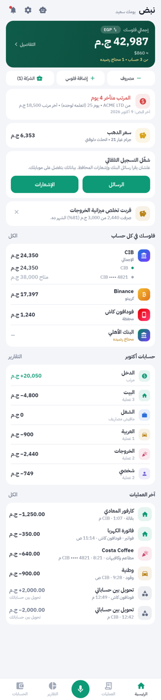
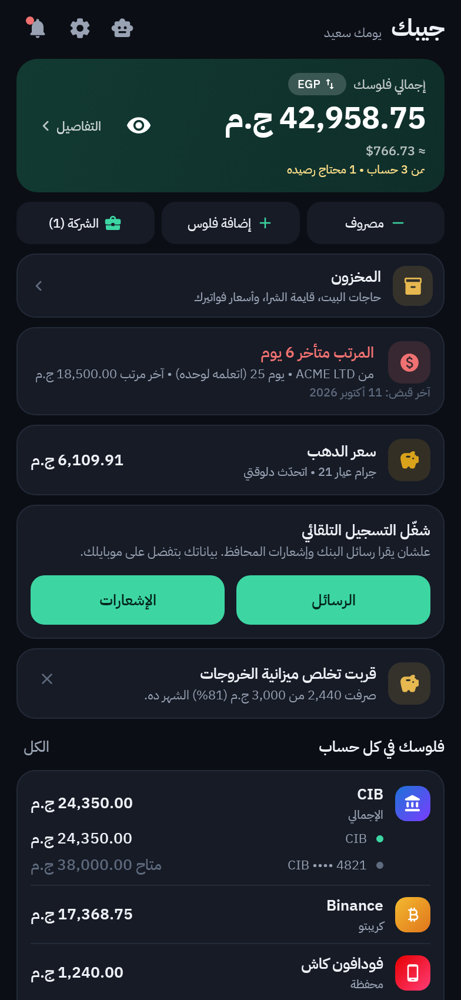
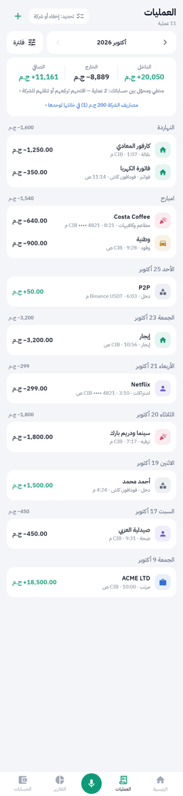
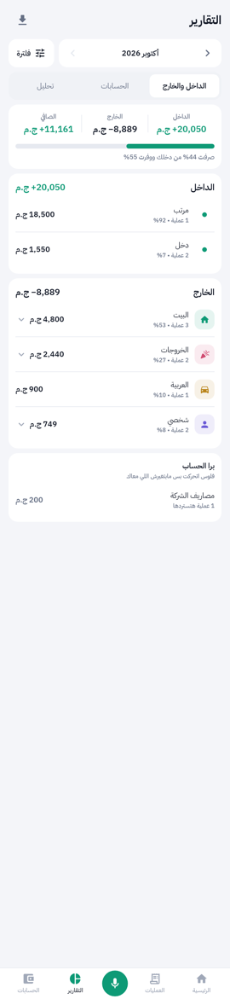
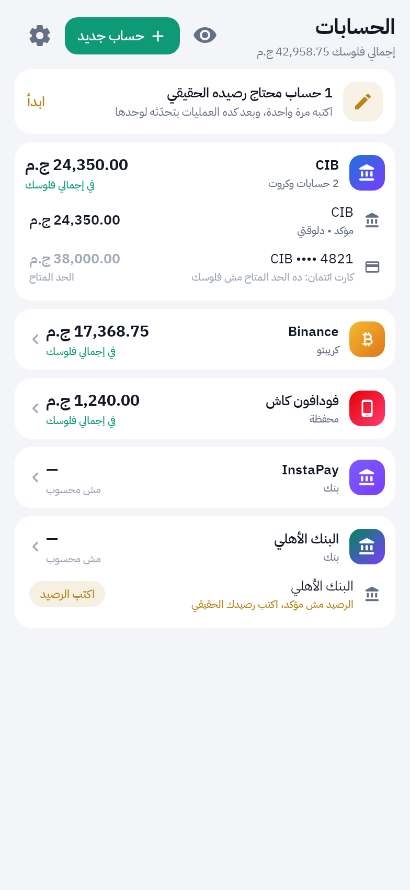
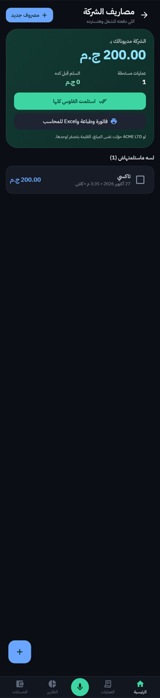
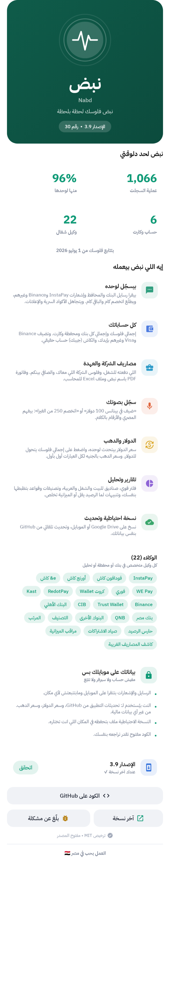

<div align="center">

# نبض · Nabd 💚

**نبض فلوسك لحظة بلحظة**

تطبيق أندرويد بالعربي لإدارة فلوسك: بيقرا رسايل البنك والمحافظ وإشعارات التطبيقات ويسجل كل حاجة لوحده،
ويقولك فلوسك راحت فين، والشركة مديونالك بكام، وسعر الدهب والدولار النهاردة.

[](https://github.com/WalidMahmoud101/nabd/releases/latest)

[](LICENSE)


[**⬇️ نزّل آخر نسخة**](https://github.com/WalidMahmoud101/nabd/releases/latest)

</div>

<div align="center">



</div>
<div align="center">




</div>

> الصور من بيانات تجريبية، مش بيانات حقيقية.

---

## المميزات

### 📥 تسجيل تلقائي بالكامل
- بيقرا **رسايل البنك** ويطلع: اتخصم كام، **الرصيد الباقي**، من أنهي كارت، وعند مين. عربي وإنجليزي وأرقام عربية.
- بيقرا **إشعارات** التطبيقات اللي مابتدّيش API: InstaPay، Binance، Trust Wallet، RedotPay، Kast، Google Pay وSamsung Pay.
- كل رسالة وإشعار جديد بيتسجل لحظتها حتى والتطبيق مقفول، ومراجعة دورية كل 6 ساعات علشان مافيش حاجة تفوت.
- **بيفهم الرسايل اللي مش عمليات** ويتجاهلها: أكواد OTP والـATM السرية، بيانات الكارت الأونلاين، الإعلانات والعروض، رسايل الباقات.
- **مفيش تكرار**: نفس العملية من رسالة وإشعار بتتسجل مرة، والتحويل بين حساباتك مابيتحسبش مصروف ولا دخل.
- كل كروت وحسابات البنك العادية في نفس البنك = **حساب واحد** (كروت الائتمان بس لوحدها).

### 💰 فلوسك وحساباتك
- **إجمالي فلوسك** في كل الحسابات، وإجمالي لكل بنك أو محفظة، وكل كارت ورصيده.
- بنوك ومحافظ: CIB، الأهلي، بنك مصر، QNB، أي بنك تاني، InstaPay، فودافون/أورنج/e&/WE كاش، فوري.
- **حسابات بتضيفها بإيدك**: Binance، Trust Wallet، Visa، Mastercard، Meeza، Google Pay، Apple Pay، RedotPay، Kast، PayPal، Wise، Payoneer، أو أي اسم. بالمبلغ اللي معاك، وإشعاراتها بتتسجل عليها لوحدها.
- **كاش (جيبي)** حساب حقيقي، و«دفعت من أنهي حساب؟» فوق في الإضافة.
- **إخفاء حساب** بالكامل (مابيتحسبش وعملياته مابتظهرش)، ورجوعه في أي وقت.
- كروت الائتمان بتتعرف لوحدها: الحد المتاح مش فلوسك.

### 🗂️ العمليات والتصنيفات
- **فلتر قوي**: فترات جاهزة (النهاردة، الأسبوع من السبت، الشهر…)، يوم أو من-إلى، غرض، تصنيف، حساب، مصدر، مبلغ، بحث. وبتحفظ فلاترك.
- الدخل والمصروف منفصلين، والبيت والشغل والعربية والخروجات كل واحد **صندوق لوحده**.
- **تحديد وإخفاء**: حدد عمليات كتير وأخفيها من الحساب (مابتتحسبش خصم ولا إضافة) أو رجّعها أو انقلها لمصاريف الشركة.
- **تصنيفاتك وقواعدك**: ضيف تصنيفات، ثبّت غرض كل تصنيف، وقواعد بأكتر من جزء بتعدله وقت ما تحب.
- **قاعدة من الرسالة**: حدد جزء من رسالة العملية (`#` = أي رقم) وسمّيها وصنّفها، وتتطبق على اللي فات واللي جاي.

### 🏢 مصاريف الشركة
- اللي بتدفعه من جيبك للشغل: الإجمالي المستحق، الكمية وسعر الوحدة، وتفاصيل كل بند.
- **استرداد من الشركة**: تحويل الشركة يقفل المصاريف المستحقة لوحده (بيقترح أنهي مصاريف بتساوي المبلغ).
- **عهدة الشركة**: فلوس الشركة اللي دخلت حسابك مش دخل ليك، وبتتقارن بالمصاريف في «الصافي».
- **فاتورة PDF** باسم نبض للطباعة، وملف **Excel (.xlsx)** للمحاسب بإجمالي بمعادلة.
- مصاريف الشركة بتفضل في خانتها ومابتخلطش بالعمليات.

### 💵 المرتب
- اكتب اسم الشركة مرة واحدة، وأي تحويل منها يتسجل مرتب. بيتعلم يوم القبض لوحده وينبهك قبلها وبيقولك متأخر كام يوم.
- حد أدنى للمبلغ و«المبلغ ده بالظبط بس».

### 💱 العملات والدهب
- **سعر الدولار** بيتزامن لوحده (واليورو والإسترليني والريال والدرهم)، ومحوّل بين العملات، وتقدر تكتب سعرك بإيدك.
- اضغط على إجمالي فلوسك فيتحول بين **الجنيه والدولار** بحركة، وكل المبالغ تتغير معاه.
- **سعر الدهب بالجنيه**: عيار 24 و21 و18 و14، الجنيه الدهب، الأوقية، رسم لآخر الأيام، وآلة حاسبة لوزنك. بيتحدث أول بأول.

### 🎙️ سجّل بصوتك
- اتكلم بالمصري: «صرفت خمسمية في كارفور للبيت امبارح»، «ضيف في بينانس 100 دولار»، «اتخصم 250 من الفيزا»، «اتبعتلي 300 على ترست والت».
- بيفهم الأرقام بالكلام والوقت والغرض والحساب، وتراجع وتحفظ بلمسة أو «احفظ على طول».

### 📊 تقارير وتحليل
- كشف الداخل والخارج، حسب الغرض والتصنيف، وحركة كل حساب، ومقارنة بالفترة اللي قبلها.
- 6 وكلاء تحليل: **المرتب، التصنيف، حارس الرصيد، صياد الاشتراكات، مراقب الميزانية، كاشف المصاريف الغريبة**.

### 🔒 النسخ الاحتياطي والتحديث
- **نسخة احتياطية** على Google Drive أو الموبايل، ومشاركتها، ونسخة تلقائية كل يوم، ورجوع منها بمعاينة.
- **ابدأ من جديد**: من أول الشهر أو مسح العمليات أو من الصفر، مع نسخة قبلها وزرار تراجع.
- **تحديث تلقائي** من GitHub بالبيانات سليمة: بيتأكد من الملف المنزّل، وله طريقة بديلة لو GitHub حدّد الطلبات.
- شاشة **«عن نبض»** (من الإعدادات أو بالضغط على اسم التطبيق): أرقامك الحقيقية، المميزات، الوكلاء، الخصوصية، الإصدار والتحديث، وروابط الكود.
- فاتح وداكن وتلقائي، وخط IBM Plex Sans Arabic، وتصميم هادي RTL.

---

## الخصوصية 🔐
- **بياناتك المالية على موبايلك بس.** مفيش حساب ولا سيرفر ولا تتبّع.
- النت بيُستخدم لـ: التحديثات من GitHub، وسعر الدولار، وسعر الدهب. مفيش بيانات مالية بتطلع.
- الصلاحيات: قراءة SMS، قراءة الإشعارات (لازم تفعّلها من الإعدادات)، وإشعارات التطبيق.
- النسخة الاحتياطية ملف JSON بتحفظه في المكان اللي تختاره.

## التثبيت
1. نزّل `nabd.apk` من [آخر نسخة](https://github.com/WalidMahmoud101/nabd/releases/latest) وثبّته (اسمح بالتثبيت من المصدر).
2. افتح التطبيق وادي صلاحيات الرسايل، وفعّل «الوصول للإشعارات» لنبض.
3. التحديثات بعد كده بتوصل من جوا التطبيق: كارت **«نزّل وثبّت»** في الرئيسية.

> التطبيق بيستخدم صلاحية SMS، فمش بيتنشر على Google Play بالشكل ده. وكل التحديثات بتتوقّع بنفس المفتاح فبياناتك بتفضل زي ما هي.

> **Apple Pay** مش بيبعت إشعارات لأندرويد، فعملياته بتتسجل بإيدك أو بالصوت.

## البناء من الكود
```bash
./gradlew assembleDebug        # APK للتجربة
./gradlew testDebugUnitTest    # الاختبارات (90+ اختبار، بيشغل Robolectric)
./gradlew assembleRelease      # APK موقّع
```
المتطلبات: JDK 17 وAndroid SDK 35.

**النشر:** زوّد `versionCode` و`versionName` في `app/build.gradle.kts`، اكتب الجديد في `RELEASE_NOTES.md`، وبعدين `./release.sh` (بيختبر ويبني وينشر release على GitHub).

## الهيكل
| المسار | الدور |
|---|---|
| `agents/MoneyParser.kt` | فهم رسايل البنوك والمحافظ (عربي/إنجليزي)، وتجاهل الـOTP والإعلانات |
| `agents/AgentEngine.kt` | المنسق: توزيع الرسايل، حذف التكرار، التحويلات الداخلية، الأرصدة، الشركة والعهدة |
| `agents/Agents.kt` · `Categorizer.kt` · `VoiceParser.kt` | الوكلاء (22)، التصنيف والقواعد، وفهم الكلام |
| `ingest/` | استقبال SMS والإشعارات، فحص الصندوق، المراجعة الدورية |
| `data/` | Room، الإعدادات، الفلتر، النسخ الاحتياطي، صافي الثروة وكشف الداخل والخارج |
| `util/` | العملات والدهب، الفاتورة وExcel، التحديث التلقائي |
| `ui/` | الواجهة بـ Jetpack Compose |

**التقنيات:** Kotlin · Jetpack Compose (Material 3) · Room · WorkManager · Robolectric.

## الترخيص
[MIT](LICENSE): مفتوح المصدر، تقدر تستخدمه وتعدّل عليه وتوزّعه، مع الإبقاء على إشعار الحقوق. البرنامج بيتقدّم «زي ما هو» من غير ضمان، وانت المسؤول عن فلوسك وقراراتك.

---

<div align="center">

اتعمل بحب في مصر 🇪🇬 · [الإبلاغ عن مشكلة](https://github.com/WalidMahmoud101/nabd/issues)

</div>
